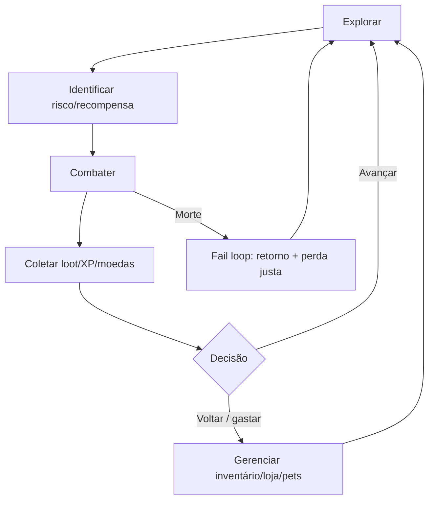
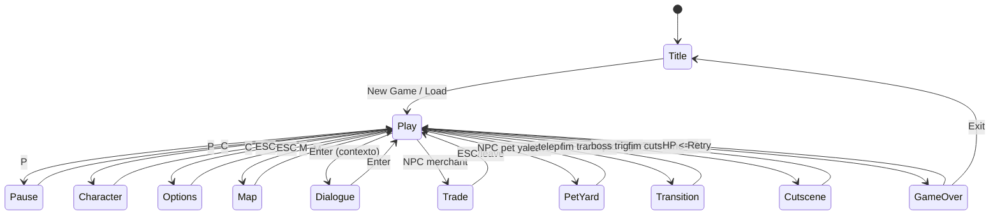

# <div align="center">Game Design Document — <b>BitHunter</b></div>
<div align="center"><sub>RPG 2D top-down de ação e exploração • progressão longa • leitura visual limpa • Java (AWT/Swing)</sub></div>
<br/>

<div align="center">
  <table>
    <tr>
      <td align="left">
        <b>📌 One-liner</b><br/>
        Explore um mundo interconectado e desça por dungeons de profundidade crescente, otimizando rotas de risco/recompensa para evoluir personagem, equipamentos e (no futuro) builds de longo prazo.
      </td>
      <td align="left">
        <b>🧾 Versão do documento</b><br/>
        <code>GDD v1.0</code> (revisão e finalização a partir do <code>gdd.md</code>)<br/>
        <b>Status do jogo</b>: protótipo/sistemas-base (com vários módulos já implementados)
      </td>
    </tr>
    <tr>
      <td align="left">
        <b>🧠 Legenda de maturidade</b><br/>
        ✅ <b>Implementado</b> • 🧭 <b>Planejado</b> • 💡 <b>Sugestão</b> • ⚠️ <b>Risco</b>
      </td>
      <td align="left">
        <b>🧩 Escopo deste GDD</b><br/>
        Define a essência do BitHunter sem inventar “como se já existisse”. Quando algo existe no código, é marcado ✅; quando é visão/backlog, 🧭; quando é proposta editorial/ajuste, 💡.
      </td>
    </tr>
  </table>
</div>

<br/>

> ✅ **Implementado** não significa “final”: significa “há evidência de funcionamento no código”.  
> 🧭 **Planejado** é intenção (pode mudar).  
> 💡 **Sugestão** é uma proposta de design/pipeline para reduzir risco e acelerar iteração.

---

## Sumário “inteligente”

<details open>
  <summary><b>📚 Abrir/fechar Sumário</b></summary>
  <br/>

- [1. Visão geral](#1-visão-geral)
  - [1.1 Introdução](#11-introdução)
  - [1.2 Pitch do jogo](#12-pitch-do-jogo)
  - [1.3 Diferenciais de proposta](#13-diferenciais-de-proposta)
  - [1.4 Público-alvo](#14-público-alvo)
  - [1.5 Plataformas e tecnologias](#15-plataformas-e-tecnologias)
- [2. Pilares e anti-pilares](#2-pilares-e-anti-pilares)
  - [2.1 Pilares (Design Pillars)](#21-pilares-design-pillars)
  - [2.2 Anti-pilares (o que BitHunter NÃO será)](#22-anti-pilares-o-que-bithunter-não-será)
  - [2.3 Fantasia do jogador & promessas](#23-fantasia-do-jogador--promessas)
  - [2.4 Experiência-alvo (Target Experience)](#24-experiência-alvo-target-experience)
  - [2.5 Diretrizes de arte e áudio](#25-diretrizes-de-arte-e-áudio)
- [3. Loop central e loops secundários](#3-loop-central-e-loops-secundários)
  - [3.1 Loop central (Mermaid)](#31-loop-central-mermaid)
  - [3.2 Loops secundários](#32-loops-secundários)
- [4. Progressão](#4-progressão)
  - [4.1 Early / Mid / Late / Endgame](#41-early--mid--late--endgame)
  - [4.2 Ascensão](#42-ascensão)
- [5. Sistemas principais](#5-sistemas-principais)
  - [5.1 Controles e inputs](#51-controles-e-inputs)
  - [5.2 Combate](#52-combate)
  - [5.3 Guarda (stamina de escudo)](#53-guarda-stamina-de-escudo)
  - [5.4 Magias e projéteis](#54-magias-e-projéteis)
  - [5.5 IA e pathfinding](#55-ia-e-pathfinding)
  - [5.6 Loot, drops e economia](#56-loot-drops-e-economia)
  - [5.7 Inventário e equipamentos](#57-inventário-e-equipamentos)
  - [5.8 Trade (comprar/vender)](#58-trade-comprarvender)
  - [5.9 Pets & incubadora](#59-pets--incubadora)
  - [5.10 Save/Load](#510-saveload)
  - [5.11 i18n (traduções) e IDs estáveis](#511-i18n-traduções-e-ids-estáveis)
  - [5.12 Mundo: mapas, mini-mapa e teleporte](#512-mundo-mapas-mini-mapa-e-teleporte)
  - [5.13 Iluminação e ciclo dia/noite](#513-iluminação-e-ciclo-dianoite)
  - [5.14 Cutscenes e boss battle](#514-cutscenes-e-boss-battle)
- [6. Mundo e geração](#6-mundo-e-geração)
- [7. UX/HUD e fluxo de telas](#7-uxhud-e-fluxo-de-telas)
  - [7.1 HUD](#71-hud)
  - [7.2 Mapa de estados/telas (Mermaid)](#72-mapa-de-estadostelas-mermaid)
  - [7.3 Diretrizes de UX](#73-diretrizes-de-ux)
  - [7.4 Acessibilidade](#74-acessibilidade)
- [8. Conteúdo (templates para expansão)](#8-conteúdo-templates-para-expansão)
  - [8.1 Inimigos e bosses](#81-inimigos-e-bosses)
  - [8.2 Itens e equipamentos](#82-itens-e-equipamentos)
  - [8.3 Facções, biomas e regiões](#83-facções-biomas-e-regiões)
- [9. Balanceamento](#9-balanceamento)
  - [9.1 Filosofia](#91-filosofia)
  - [9.2 Parâmetros e limites](#92-parâmetros-e-limites)
  - [9.3 Tabelas atuais (preservadas) + justificativas](#93-tabelas-atuais-preservadas--justificativas)
  - [9.4 Método de balanceamento (como ajustar sem quebrar)](#94-método-de-balanceamento-como-ajustar-sem-quebrar)
  - [9.5 Telemetria opcional (offline)](#95-telemetria-opcional-offline)
- [10. Pipeline de conteúdo](#10-pipeline-de-conteúdo)
  - [10.1 Templates prontos](#101-templates-prontos)
  - [10.2 Checklist de integração](#102-checklist-de-integração)
- [11. Definition of Done (DoD)](#11-definition-of-done-dod)
- [12. Plano de testes de gameplay + checklist de build](#12-plano-de-testes-de-gameplay--checklist-de-build)
- [13. Roadmap & backlog priorizado](#13-roadmap--backlog-priorizado)
- [14. Riscos e mitigação](#14-riscos-e-mitigação)
- [15. Glossário](#15-glossário)
- [Apêndices](#apêndices)
  - [A. Fórmulas e tabelas do GDD base (preservadas)](#a-fórmulas-e-tabelas-do-gdd-base-preservadas)
  - [B. Sistema de IDs e i18n (texto expandido)](#b-sistema-de-ids-e-i18n-texto-expandido)
  - [C. GDD base original (preservação integral)](#c-gdd-base-original-preservação-integral)

</details>

---

## 1) Visão geral

### 1.1) Introdução

**BitHunter** é um RPG 2D top-down de ação e exploração. O jogador é lançado em um mundo desconhecido, sem uma narrativa prévia ou uma história linear que se desenvolva ao longo do jogo. O foco é uma **aventura praticamente infinita**, em que o jogador pode **explorar e reexplorar** ambientes (no estilo **Tibia**).

No longo prazo, haverá **dungeons infinitas** nas quais o jogador desce e avança continuamente, com **aumento progressivo de dificuldade** e **recompensas melhores** (inspiradas na **Torre de DanMachi** e na **Mina de Caverna** de *Stardew Valley*).

Também está nos planos um **modo multijogador colaborativo** e mecânicas de **end-game**, como **refinamento e nivelamento de equipamentos**, **roda de habilidades** (como em **Tibia**) e um sistema de **ascensão**, no qual o personagem é resetado em troca de **bônus permanentes**.

**Inspirações**

- **Pokémon FireRed**
- **The Legend of Zelda: A Link to the Past (SNES)**
- **Rucoy Online**
- **Tibia** (loop de exploração/reexploração e progressão longa)
- **DanMachi** (conceito de torre/andar)
- **Stardew Valley** (minas com progressão de profundidade)

### 1.2) Pitch do jogo

**BitHunter** é um RPG 2D top-down de ação e exploração focado em progressão consistente e rejogabilidade. Em um mundo sem narrativa linear, o jogador avança por áreas interconectadas e **dungeons de profundidade infinita**, onde a dificuldade cresce de forma previsível e as recompensas acompanham o risco. O ciclo central é direto: **explorar → enfrentar inimigos → obter recursos → evoluir o personagem e o equipamento**.

O projeto prioriza **clareza mecânica**, **leitura visual limpa** e **desempenho estável**, com sistemas de progressão de longo prazo (refino e nivelamento de equipamentos, árvore/roda de habilidades e **ascensão** com bônus permanentes). A visão inclui **modo cooperativo** para coordenação de rotas e papéis, mantendo o foco em decisões táticas e domínio do mapa.

### 1.3) Diferenciais de proposta

- Progressão longa sem depender de enredo: desafio e recompensa como motor do jogo.
- Dungeons infinitas com escalonamento transparente de risco/recompensa.
- End-game orientado a builds, metas pessoais e eficiência de rotas.
- Base técnica enxuta para atualizações frequentes de conteúdo e balanceamento.

### 1.4) Público-alvo

- **Eu/estudo pessoal:** projeto de aprendizado e prática de engenharia de jogos em **Java**, priorizando performance, clareza e ciclos curtos de iteração.
- **Amigos/testers e comunidade indie:** jogadores de **RPG 2D top-down** que curtem progresso longo, exploração recorrente e **dungeons de profundidade** sem foco em narrativa linear.
- **Dev-entusiastas/open source:** interessados em ler, testar e contribuir com código limpo (HUD, IA simples, iluminação, balanceamento de risco/recompensa).
- **Perfil de jogo esperado:** sessões curtas a médias, progresso cumulativo, leitura visual clara, dificuldade crescente previsível e baixo consumo de recursos.

### 1.5) Plataformas e tecnologias

- **Plataforma:** PC (Windows/Linux/Mac)
- **Engine/Stack:** Java puro + AWT/Swing (render 2D), projeto modular
- **Arte:** Pixel art
- **Áudio:** efeitos leves e trilhas em loop (formato otimizado)

---

## 2) Pilares e anti-pilares

### 2.1) Pilares (Design Pillars)

<div>
  <table>
    <tr>
      <td width="50%">
        <b>1) Legibilidade acima de “complexidade”</b><br/>
        O jogador entende o que aconteceu e por quê (dano, risco, recompensa, falha). UI, feedbacks e regras são consistentes.
      </td>
      <td width="50%">
        <b>2) Risco/Recompensa transparente</b><br/>
        O jogo deixa claro “o quanto custa” avançar (dano, consumo, tempo) e “o quanto vale” (loot, XP, rotas).
      </td>
    </tr>
    <tr>
      <td>
        <b>3) Progressão longa sem depender de narrativa</b><br/>
        O motor de motivação é melhoria incremental + domínio de rota + builds (no futuro).
      </td>
      <td>
        <b>4) Base enxuta e performática</b><br/>
        Sistemas simples, extensíveis e baratos (overlay de iluminação, UI modular, tiles + entidades ordenadas).
      </td>
    </tr>
  </table>
</div>

### 2.2) Anti-pilares (o que BitHunter NÃO será)

- **Não** será um RPG focado em “história linear obrigatória” (anti-pilar: cutscenes longas e intrusivas).
- **Não** será um jogo com “buildcrafting” hiper opaco (anti-pilar: 40 stats escondidos sem explicação).
- **Não** será “hardcore punitivo por padrão” (anti-pilar: perda total de progressão por morte).  
  🧭 A punição de morte deve existir, mas ser **justa** e **aprendível**.
- **Não** dependerá de grind infinito sem decisões (anti-pilar: farm sem escolhas).

### 2.3) Fantasia do jogador & promessas

**Fantasia principal:** “Eu sou um caçador/aventureiro que aprende o mapa, domina o combate e fica cada vez mais eficiente — como uma rotina de progresso ‘infinita’, mas controlada.”

**Promessas do jogo (Player Promises)**

- **Promessa 1 — domínio do espaço:** rotas e atalhos importam.
- **Promessa 2 — upgrades sentem no gameplay:** cada aumento de poder muda o jeito de jogar (mesmo que pouco).
- **Promessa 3 — feedback honesto:** dano/erro é legível; o jogador sabe o que fez de certo/errado.
- **Promessa 4 — tempo respeitado:** sessões curtas funcionam; o jogo não exige “maratonas”.

### 2.4) Experiência-alvo (Target Experience)

> 🧭 **Planejado**: metas de “experiência alvo” são parâmetros de design; não significam que o jogo já entrega isso em 100%.

| Dimensão | Meta | Observações |
|---|---|---|
| Ritmo | ciclos curtos “explorar → lutar → loot → decidir” | reduzir downtime, manter decisões frequentes |
| Densidade | encontros curtos com pausas seguras | evitar “sala vazia demais” e evitar “overwhelm” |
| Dificuldade | curva previsível (progressiva) | o jogador deve conseguir prever risco |
| Sessão | 10–25 min (jogável) / 30–60 min (otimização) | 💡 ideal para playtests rápidos |
| Meta-objetivo | “melhorar rota” + “melhorar build” | build entra mais forte no endgame 🧭 |

### 2.5) Diretrizes de arte e áudio

✅ **Implementado (diretriz já declarada no GDD base)**: **Pixel Art**.

🧭 **Planejado**: diretrizes mais explícitas (para produção consistente de assets e leitura de gameplay).

<div>
  <table>
    <tr>
      <td width="50%">
        <b>Arte (high-level)</b><br/>
        - Silhuetas claras (player/inimigos/itens)<br/>
        - Contraste funcional (HUD e mundo)<br/>
        - Telegráfos simples: animação curta + postura + cor<br/>
      </td>
      <td width="50%">
        <b>Áudio (high-level)</b><br/>
        - SFX curtos e “secos” (sem mascarar informação)<br/>
        - Trilhas em loop discretas por região/estado<br/>
        - Mix favorável à clareza (hit, pickup, menu, boss)<br/>
      </td>
    </tr>
  </table>
</div>

💡 **Sugestão (paleta e linguagem visual, sem engessar)**:

- **Mundo**: base mais escura/sóbria para favorecer leitura de HUD e efeitos (iluminação, partículas).
- **Destaques**:
  - interação (porta/baú) com outline/realce
  - perigo (pit/hazard) com leitura antes do dano
  - drops importantes com brilho/outline leve (evitar poluição)
- **UI**: 3 cores “fixas” (texto, fundo, acento) + 1 cor de alerta (baixo HP, falta de mana).

---

## 3) Loop central e loops secundários

### 3.1) Loop central (Mermaid)



### 3.2) Loops secundários

#### Economia (compra/venda / sinks)

- 🧭 **Planejado**: “sinks” de upgrades/refino e desbloqueios.
- ✅ **Implementado**: trade comprar/vender com checagem de moedas/inventário (sistema base).

#### Dungeon (profundidade, checkpoints, escalonamento)

- 🧭 **Planejado**: dungeons “de profundidade” com checkpoints e escalonamento transparente.
- ✅ **Implementado** (base): múltiplos mapas e teleporte entre áreas; boss room com cutscene e progress flag.

#### Pets (coleção, incubação, progresso)

- ✅ **Implementado**: colecionar pets, equipar/desequipar, ganhar XP, incubar ovos com custo e tempo.

---

## 4) Progressão

### 4.1) Early / Mid / Late / Endgame

> 🧭 **Planejado**: o GDD define o “arco”; o conteúdo final depende de número de regiões, itens e inimigos.

<div>
  <table>
    <tr>
      <td width="25%"><b>Early</b><br/><sub>Aprender leitura + regras</sub></td>
      <td width="25%"><b>Mid</b><br/><sub>Otimizar rota + tradeoffs</sub></td>
      <td width="25%"><b>Late</b><br/><sub>Especializar build</sub></td>
      <td width="25%"><b>Endgame</b><br/><sub>Metas longas</sub></td>
    </tr>
    <tr>
      <td>
        ✅ loop básico, itens iniciais, primeiros inimigos<br/>
        ✅ UI/HUD legível<br/>
        ✅ eventos de mundo (teleporte, cura, etc.)<br/>
      </td>
      <td>
        🧭 diversidade de inimigos/salas<br/>
        🧭 economia com sinks reais (refino, crafting)<br/>
        🧭 “soft gates” por recomendação de poder<br/>
      </td>
      <td>
        🧭 talentos/roda de habilidades<br/>
        🧭 variações de resistência/elementos<br/>
        🧭 endereçar power spikes (builds)<br/>
      </td>
      <td>
        🧭 ascensão + bônus permanentes<br/>
        🧭 dungeons infinitas “de verdade”<br/>
        🧭 metas pessoais e otimização de eficiência<br/>
      </td>
    </tr>
  </table>
</div>

### 4.2) Ascensão

- 🧭 **Planejado**: resetar parte da progressão do personagem em troca de bônus permanentes (QoL + pequenos percentuais).  
- 💡 **Sugestão**: formalizar uma **tabela de bônus** com limites (caps) e custos crescentes para evitar “ascension power creep” irreversível.

---

## 5) Sistemas principais

### 5.1) Controles e inputs

✅ **Implementado** (baseado no `KeyHandler`):

- **W/A/S/D**: mover (e navegar em grids de inventário)
- **Enter**: confirmar/interagir/atacar
- **P**: pausar/retomar
- **C**: abrir/fechar status do personagem
- **Esc**: abrir opções / voltar
- **F**: disparo/magia (projétil)
- **Space**: guarda (quando possível)
- **M**: tela de mapa
- **X**: alternar mini-mapa
- **T**: debug/path (dev)
- **R**: recarregar mapa (dev)
- **G**: “god mode” (dev)

⚠️ **Risco (consistência)**: o atalho `R` recarrega um arquivo com nome diferente do arquivo existente (`interior01` vs `indoor01`).  
💡 **Sugestão**: padronizar nomenclatura e criar uma tabela única de mapas (IDs) para reduzir drift.

### 5.2) Combate

✅ **Implementado**

- **Ataque melee**: acionado por `Enter`, com hitbox temporária.
- **Dano base**: \( \text{dano} = \text{ataque} - \text{defesa} \), com clamp mínimo (depende do contexto: player vs monstro).
- **i-frames**: player tem janela maior (~60 frames no código); entidades genéricas possuem invincibilidade curta (~20 frames).
- **Knockback**: armas podem empurrar; monstros também podem empurrar o player.

🧭 **Planejado**

- ataques pesados
- stagger/poise
- elementos/resistências
- telegráfos mais ricos (sem perder legibilidade)

💡 **Sugestão (sem quebrar essência)**: formalizar “camadas” do combate:

- **Camada 1 (core)**: posição, tempo, leitura (já existe).
- **Camada 2 (variação)**: status/elementos (planejado).
- **Camada 3 (build)**: talentos/equipamentos com sinergias (planejado).

### 5.3) Guarda (stamina de escudo)

✅ **Implementado**

- cada escudo tem `GuardStaminaCap` (capacidade)
- segurar `Space` drena stamina com intervalo
- tomar hit em guarda consome stamina proporcional ao ataque do monstro (mínimo)
- stamina regenera com delay após soltar `Space`

🧭 **Planejado**

- expandir para “parry” com timing mais explícito (hoje já existe uma janela implícita por `guardCounter`)
- adicionar feedback de “perfeito/ok/falhou” na UI

### 5.4) Magias e projéteis

✅ **Implementado**

- `F` dispara projétil (ex.: Fireball) se houver recurso (mana) e cooldown.

🧭 **Planejado**

- skill wheel/árvore de habilidades
- variações de projéteis (com custo, utilidade, CC)

### 5.5) IA e pathfinding

✅ **Implementado**

- base de entidades com `setAction()`, `onPath`, e A* (`PathFinder`)
- máscara de sólidos inclui tiles e tiles interativos destrutíveis

🧭 **Planejado**

- FSM formal (patrulha→perseguir→atacar→recuar)
- percepção (raio/cone) e aggro timers

### 5.6) Loot, drops e economia

✅ **Implementado**

- estrutura de loot: `checkDrop()` + `dropItem()`
- moedas/consumíveis básicos e trade (comprar/vender)

🧭 **Planejado**

- bad-luck protection e tabelas de drop com piso/teto
- sinks: crafting/imbuir, refino, desbloqueios
- materiais e raridade por profundidade

### 5.7) Inventário e equipamentos

✅ **Implementado**

- inventário até 20 itens (grid 5 colunas)
- stack (`amount`)
- destaque de equipados (arma/escudo/luz/botas/armaduras)
- descrições via i18n (nome/desc)

🧭 **Planejado**

- slots adicionais (armadura completa) com conteúdo real e progressão
- atalhos rápidos (consumível, etc.)

### 5.8) Trade (comprar/vender)

✅ **Implementado**

- compra: valida coins e capacidade de inventário
- venda: vende por metade do preço; impede vender equipados (com diálogo)

🧭 **Planejado**

- estoque dinâmico
- preços por região/dificuldade
- itens raros/rotativos

### 5.9) Pets & incubadora

✅ **Implementado**

- coleção de pets (IDs estáveis)
- pet ativo com level/XP e HUD dedicado
- incubação: custo em moedas + tempo em ticks, progresso e mensagens

🧭 **Planejado**

- variedade de pets com papéis claros (ofensivo/defensivo/utilitário)
- sinergias com biomas/inimigos

### 5.10) Save/Load

✅ **Implementado**

- salva `DataStorage` em `save.dat`
- restaura stats, inventário (por `internalId`), equipamentos (por slots), objetos no mapa (id/pos/loot/opened), pets e incubadora

⚠️ **Risco (compatibilidade)**: mudanças em `internalId`, slots ou `DataStorage` podem quebrar saves antigos.  
💡 **Sugestão**: criar estratégia de versão do save (ex.: `saveVersion`) e migração leve (tolerância a campos faltantes).

### 5.11) i18n (traduções) e IDs estáveis

✅ **Implementado**

- `internalId` (ID técnico estável para save/load e geração)
- `translationKey` (chave base para `.properties`)
- fallback `??key??` quando falta tradução

> Veja Apêndice [B](#b-sistema-de-ids-e-i18n-texto-expandido) para o texto expandido e exemplos.

### 5.12) Mundo: mapas, mini-mapa e teleporte

✅ **Implementado**

- múltiplos mapas (`resource/maps/*.txt`)
- **tela de mapa** e **mini-mapa** (toggle)
- teleporte e eventos por tiles (pit, pool de cura, entradas/saídas, trigger de boss)

🧭 **Planejado**

- dungeons infinitas (geração procedural real)
- marcadores e leitura de risco/recompensa por sala

### 5.13) Iluminação e ciclo dia/noite

✅ **Implementado**

- overlay com gradiente radial quando há fonte de luz
- fases do dia (DAY/DUSK/NIGHT/DAWN) ajustando alpha

🧭 **Planejado**

- clima (chuva/névoa)
- impacto real em spawn/percepção/IA (além do visual)

### 5.14) Cutscenes e boss battle

✅ **Implementado**

- cutscene do Skeleton Lord: fecha porta, move player, acorda boss, diálogo, troca música
- flag de progresso: `Progress.isSkeletonLordDefeated()`

💡 **Sugestão**: padronizar “estrutura de boss”:

- **Entrada**: trava arena + setup
- **Faseamento**: thresholds (HP%, timers)
- **Saída**: drop + desbloqueio + progress flag + cleanup

---

## 6) Mundo e geração

✅ **Implementado** (base)

- mundo com mapas fixos em texto
- áreas (Outside/Indoor/Dungeon) influenciam música e iluminação
- eventos por tiles (teleporte, pit, heal pool, boss trigger)

🧭 **Planejado** (expansão sem mudar essência)

- **regiões** com identidade (bioma + inimigos + loot)
- **dungeons de profundidade**:
  - escalonamento previsível (HP/ATK/DEF/loot)
  - checkpoints a cada \(N\) andares
  - “regras de sala” (ex.: elite, evento, tesouro, cura)

💡 **Sugestão**: definir **contratos de geração** antes do procedural:

- **Input**: “andar X”, seed, bioma
- **Output**: grade de salas + conectividade + spawn table
- **Restrições**: garantir rota mínima, garantir descanso periódico, evitar “soft lock”

---

## 7) UX/HUD e fluxo de telas

### 7.1) HUD

✅ **Implementado** (sistema atual)

- barras HP/MP e (se houver) Guarda
- XP no topo (barra fina)
- mensagens rápidas (feed)
- HUD do pet (ícone + nível + barra de XP)
- HP bar de monstros (normal) e barra de boss (central)

🧭 **Planejado**

- indicadores de status (veneno/sangramento/buffs)
- melhorias de acessibilidade (tamanho de fonte, redução de motion)

### 7.2) Mapa de estados/telas (Mermaid)



### 7.3) Diretrizes de UX

- **Um input, uma consequência**: evitar que a mesma tecla tenha resultados “surpresa” sem feedback.
- **Feedback antes de punição**: telegráfos e sinais devem existir antes do dano (quando possível).
- **UI como instrumento**: barras e mensagens devem acelerar a tomada de decisão (não “encher a tela”).

### 7.4) Acessibilidade

✅ **Implementado**

- alto contraste funcional + sombra de texto
- navegação por teclado com foco visual

🧭 **Planejado**

- ajuste de tamanho de fonte
- redução de motion (fades/transições)
- indicadores auditivos opcionais
- modos de contraste (presets)

💡 **Sugestão**: “Acessibilidade como presets”, não como 30 toggles:

- Preset **Conforto**: menos motion + fontes maiores
- Preset **Performance**: minimal UI, sem suavização
- Preset **Contraste**: cores reforçadas + outline

---

## 8) Conteúdo (templates para expansão)

### 8.1) Inimigos e bosses

✅ **Conteúdo atual (GDD base)**: ver tabela preservada no Apêndice [A](#a-fórmulas-e-tabelas-do-gdd-base-preservadas).

💡 **Template — Inimigo**

| Campo | Tipo | Descrição |
|---|---|---|
| `internalId` | string | ex.: `monster.greenSlime` |
| Papel | enum | `trash`, `skirmisher`, `elite`, `boss` |
| HP/ATK/DEF/SPD | ints | stats base e escalonamento |
| Telegráfos | texto | como o jogador “lê” ataques |
| Drops | tabela | moedas, consumíveis, materiais |
| Risco/recompensa | texto | por que lutar vs evitar |

💡 **Template — Boss**

- **Trigger**: como inicia (evento, porta, cutscene)
- **Arena**: restrições e leitura
- **Fases**: thresholds e mudanças
- **Drops/Desbloqueios**: o que libera e como afeta o mundo
- **Fail loop**: como morte é tratada (justiça + aprendizado)

### 8.2) Itens e equipamentos

✅ **Conteúdo atual (GDD base)**: armas, escudos/botas, poção e fireball (ver Apêndice A).

💡 **Template — Item**

| Campo | Descrição |
|---|---|
| `internalId` | ID estável para save/load/geração |
| `translationKey` | base para `.name` / `.desc` / mensagens |
| Tipo | arma, escudo, consumível, luz, etc. |
| Stats | attack/defense/speed/lightRadius/guardCap |
| Preço | compra e venda (regra de metade na venda) |
| Stack | se empilha, cap (se houver) |

### 8.3) Facções, biomas e regiões

🧭 **Planejado**

- facções por área para modular agressividade e loot
- biomas com regras (visão, iluminação, inimigos, drops)

💡 **Sugestão**: “bioma como pacote”:

- paleta (alto nível)
- inimigos típicos
- drops e materiais
- 1–2 regras de gameplay (ex.: visibilidade, slow, hazards)

---

## 9) Balanceamento

### 9.1) Filosofia

- **Legibilidade > surpresa**: o jogador precisa conseguir estimar risco.
- **Progressão consistente**: upgrades pequenos, mas frequentes e perceptíveis.
- **Sem degraus injustos**: spikes de dificuldade precisam de telegráfo e alternativa (rota, farm, item).

### 9.2) Parâmetros e limites

💡 **Sugestão**: tratar como “painel de knobs” (controláveis) para balancear sem reescrever sistemas:

- XP: curva de `nextLevelExp`
- HP/ATK/DEF: progressão do player por nível e por item
- Preço: baseline por região
- Drops: probabilidade e proteção contra azar
- Guard: drain, regen, custo por hit, janela de parry

### 9.3) Tabelas atuais (preservadas) + justificativas

✅ **Preservadas** no Apêndice [A](#a-fórmulas-e-tabelas-do-gdd-base-preservadas).

⚠️ **Inconsistência detectada (GDD vs código)**:

- No texto base, a progressão de XP menciona “dobrar” `nextLevelExp`, mas a tabela/fórmula final e o código usam outra lógica.  
- Este GDD final mantém a tabela/fórmula e recomenda alinhar o texto (ver método abaixo).

### 9.4) Método de balanceamento (como ajustar sem quebrar)

💡 **Processo recomendado (pragmático)**

1. **Defina um alvo mensurável** por trecho de jogo (early/mid/boss):
   - “quantos hits o player aguenta”
   - “quantos hits para matar inimigo”
   - “tempo médio para 1 nível”
2. **Mexa em uma alavanca por vez** (XP ou HP ou drop), não em tudo.
3. **Trave limites** para evitar regressão:
   - clamp de dano mínimo (já existe em alguns casos)
   - caps de bônus (planejado)
4. **Valide com um micro-playtest** (ver seção de testes).

💡 **Regras de ouro**

- Se você aumenta dano dos monstros, revise também:
  - custo/eficácia de consumíveis
  - acesso a guarda (stamina) e ao trade
- Se você aumenta XP, revise:
  - preço de itens (economia)
  - drops (porque XP mais rápido gera mais moedas por tempo)

### 9.5) Telemetria opcional (offline)

💡 **Sugestão**: mesmo sem analytics online, dá para registrar em arquivo local (ou log) para balancear:

- tempo por sessão
- mortes por área/inimigo
- dano recebido por fonte (melee, projétil, hazard)
- tempo para 1 nível
- moedas ganhas/gastas por minuto
- itens mais comprados/vendidos
- taxa de uso de poções / “heal pool”
- incubação: quantas iniciadas/concluídas

---

## 10) Pipeline de conteúdo

### 10.1) Templates prontos

- Template de inimigo (ver [8.1](#81-inimigos-e-bosses))
- Template de item (ver [8.2](#82-itens-e-equipamentos))

### 10.2) Checklist de integração

✅ **Observado no código (padrão atual)**

- **Item/objeto**:
  - criar classe em `object/`
  - definir `OBJ_ID` (`internalId`) estável
  - adicionar ao `EntityGenerator.getObject(...)`
  - adicionar chaves em `resource/lang/messages_*.properties`
  - (opcional) posicionar em mundo via `AssetSetter`
- **Pet/ovo**:
  - criar `PetEntity` + `PetEgg`
  - registrar em `PetFactory`
  - chaves i18n para `.name/.desc` e mensagens do Pet Yard
- **Monstro/boss**:
  - criar classe em `monster/`
  - definir drop e comportamento em `setAction()/checkDrop()`
  - posicionar via `AssetSetter` e/ou eventos
  - se boss: integrar em cutscene/progress

💡 **Sugestão**: criar um arquivo único “registry” por conteúdo (monstros/itens/pets) para reduzir switch-case grande com o tempo.

---

## 11) Definition of Done (DoD)

> 💡 **Sugestão**: critérios objetivos evitam “parece pronto, mas não está”.

**DoD — Sistema**

- Regras documentadas (este GDD)
- Controles e feedback definidos
- Estados e transições validados (não trava)
- Pelo menos 3 test cases passando (ver seção 12)
- i18n: chaves `pt_BR` presentes (e fallback não quebra UI)

**DoD — Conteúdo (inimigo/item)**

- `internalId` estável e registrado
- Nome/descrição em i18n
- Spawn/obtenção possível no jogo
- Balanceamento básico (hits para matar / hits para morrer)
- Drop/economia não explode (não gera moedas infinitas sem custo)

---

## 12) Plano de testes de gameplay + checklist de build

### Test cases rápidos (gameplay)

✅ **Baseado no que o jogo já suporta**

- **T1 — loop de combate**: matar 3 inimigos sem soft-lock e ver mensagens de dano/XP.
- **T2 — trade**: comprar 1 item com moedas suficientes e tentar comprar sem moedas (deve bloquear com diálogo).
- **T3 — inventário**: empilhar item stackable e ver contador; vender item não-equipado; tentar vender equipado (bloquear).
- **T4 — mapa**: abrir/fechar mapa; ligar/desligar mini-mapa.
- **T5 — save/load**: salvar, fechar e carregar; inventário, equipamento e objetos no mapa devem persistir.
- **T6 — pet yard**: incubar um ovo (com moedas) e ver progresso; concluir e equipar pet.
- **T7 — guarda**: segurar `Space` e observar drain; receber hit em guarda e verificar consumo; regenerar após delay.

### Checklist de build (mínimo)

- O jogo abre e entra no `PLAY_STATE`
- Troca de estados funciona (map/options/trade/pet yard)
- Não há crash de resource load (assets no classpath)

---

## 13) Roadmap & backlog priorizado

> 🧭 **Planejado**: prioridades ajudam a manter essência sem “feature creep”.

### P0 (fundação jogável e confiável)

- **Assets no repositório / pipeline de assets** (para rodar do zero)  
  Critério: jogo roda sem missing resources.
- **Alinhar inconsistências GDD↔código** (mapa/XP/teclas/fórmulas)  
  Critério: GDD espelha o comportamento atual + separa claramente o planejado.
- **Drops e economia mínima estável**  
  Critério: comprar/vender + drops básicos não geram loops infinitos triviais.

### P1 (profundidade e variedade)

- **Variedade de inimigos** com papéis claros (trash/skirmisher/elite)  
- **Mais eventos e “salas” com risco/recompensa**
- **Sistema de materiais** (craft/imbuir) com sinks reais

### P2 (visão longa)

- **Dungeons infinitas procedurais**
- **Talentos/roda de habilidades**
- **Ascensão**
- **Coop** (se e quando fizer sentido técnico)

---

## 14) Riscos e mitigação

| Risco | Tipo | Impacto | Mitigação |
|---|---|---:|---|
| Assets não versionados (missing `.png/.wav/.ttf`) | Tech | Alto | P0: pipeline de assets + validação no boot |
| Drift GDD↔código | Design/Prod | Médio | DoD: GDD atualizado por release; seção “Implementado vs Planejado” |
| Save quebra com mudanças | Tech | Alto | versão do save + tolerância a campos |
| Curva de dificuldade “espeta” | Design | Médio | método de balanceamento + micro-playtests |
| Complexidade de registries (switch-case crescendo) | Tech | Médio | registrar conteúdo via tabelas/JSON ou registry central |
| i18n sem suporte de fonte (alfabetos) | UX | Médio | limitar idiomas expostos ou embutir fontes adequadas |

---

## 15) Glossário

- **i-frames**: frames de invencibilidade após tomar dano.
- **Hard gate**: bloqueio “duro” (ex.: porta com chave) que impede passar.
- **Soft gate**: recomendação de poder (passa, mas é difícil).
- **Skill gate**: progressão por habilidade do jogador (leitura/timing).
- **Fail loop**: ciclo após falha (morte) que devolve o jogador ao loop central sem destruir a motivação.
- **Telegráfo**: pista visual/sonora que antecipa uma ameaça/ataque.
- **Knockback**: recuo aplicado por ataque.
- **Bad-luck protection**: regra que reduz o azar extremo em drops.

---

## Apêndices

### A) Fórmulas e tabelas do GDD base (preservadas)

> ✅ **Preservação**: as tabelas abaixo vêm do `gdd.md` base. Aqui elas estão reunidas para consulta e balanceamento.

#### Player – Progressão de Status (Níveis 1–10)

> Premissas:
>
> - HP inicial: 12, +3 por nível.
> - MP inicial: 6, **não** aumenta por enquanto.
> - STR: +1 por nível.
> - DEX: +1 em níveis pares.
> - Ataque c/ Espada Normal = `STR * 2`.
> - Defesa c/ Escudo de Madeira = `DEX * 1`.

| Nível | HP Máx | MP Máx | STR | DEX | Ataque (Espada Normal) | Defesa (Escudo Madeira) | XP total p/ próximo nível |
| ----- | ------ | ------ | --- | --- | ---------------------- | ----------------------- | ------------------------- |
| 1     | 12     | 6      | 2   | 1   | 4                      | 1                       | 10                        |
| 2     | 15     | 6      | 3   | 2   | 6                      | 2                       | 21                        |
| 3     | 18     | 6      | 4   | 2   | 8                      | 2                       | 35                        |
| 4     | 21     | 6      | 5   | 3   | 10                     | 3                       | 52                        |
| 5     | 24     | 6      | 6   | 3   | 12                     | 3                       | 72                        |
| 6     | 27     | 6      | 7   | 4   | 14                     | 4                       | 95                        |
| 7     | 30     | 6      | 8   | 4   | 16                     | 4                       | 121                       |
| 8     | 33     | 6      | 9   | 5   | 18                     | 5                       | 150                       |
| 9     | 36     | 6      | 10  | 5   | 20                     | 5                       | 182                       |
| 10    | 39     | 6      | 11  | 6   | 22                     | 6                       | 217                       |

#### Fórmulas de Combate (GDD)

| Conceito                   | Fórmula / Regra                                                                                            |
| -------------------------- | ---------------------------------------------------------------------------------------------------------- |
| Ataque base do Jogador     | `AttackJogador = STR * weapon.attackValue`                                                                 |
| Defesa base do Jogador     | `DefenseJogador = DEX * shield.defenseValue + soma(defesaBoots + defesaHelmet + defesaChest + defesaLegs)` |
| Dano do Jogador no Monstro | `dano = AttackJogador - DefenseMonstro` (se < 0, vira 0)                                                   |
| Dano do Monstro no Jogador | `dano = AttackMonstro - DefenseJogador` (se < 1, vira 1)                                                   |
| XP para próximo nível      | Começa em **10** no nível 1. Ao subir de nível: `NextLevelExp = NextLevelExp + 5 + (novoNível * 3)`        |

#### Monstros – Status Gerais

| ID Interno             | Nome (GDD)    | HP Máx | ATK                     | DEF | SPD (default)         | EXP | Observações de Comportamento / Drops |
| ---------------------- | ------------- | ------ | ----------------------- | --- | --------------------- | --- | ------------------------------------ |
| `monster.greenSlime`   | Green Slime   | 8      | 3                       | 0   | 1                     | 3   | Inimigo básico; drops base.          |
| `monster.bat`          | Bat           | 10     | 4                       | 0   | 4                     | 5   | Rápido; drops base.                  |
| `monster.redSlime`     | Red Slime     | 16     | 7                       | 2   | 2                     | 10  | Mid; mais agressivo.                 |
| `monster.orc`          | Orc           | 30     | 9                       | 3   | 1                     | 20  | Elite; knockback.                    |
| `monster.skeletonLord` | Skeleton Lord | 80     | 10 / 15                 | 4   | 1 / 2                 | 100 | Boss; rage em <50% HP.               |

#### Equipamentos Ofensivos (Armas / Ferramentas)

| ID Interno         | Nome (GDD)    | Tipo    | AttackValue | Área de Ataque (LxA) | KnockBack | Motion1 | Motion2 | Preço | Observações |
| ------------------ | ------------- | ------- | ----------: | -------------------: | --------: | ------: | ------: | ----: | ----------- |
| `item.swordNormal` | Espada Normal | Sword   |           2 |                36×36 |         2 |       5 |      25 |    30 | Arma inicial. |
| `item.axe`         | Machado       | Axe     |           3 |                30×30 |        10 |      25 |      50 |   120 | Dano alto, lento. |
| `item.pickaxe`     | Picareta      | Pickaxe |           2 |                30×30 |         6 |      15 |      30 |    60 | Ferramenta/arma. |

#### Equipamentos Defensivos

| ID Interno        | Nome (GDD)        | Tipo   | DefenseValue | GuardStaminaCap | SpeedValue | Preço | Observações |
| ----------------- | ----------------- | ------ | -----------: | --------------: | ---------: | ----: | ----------- |
| `item.shieldWood` | Escudo de Madeira | Shield |            1 |              40 |          0 |    40 | Early. |
| `item.shieldBlue` | Escudo Azul       | Shield |            3 |              80 |          0 |   300 | Mid. |
| `item.boots`      | Botas de Couro    | Boots  |            1 |               – |          1 |   400 | +speed. |

#### Magias e Consumíveis

| ID Interno      | Nome (GDD) | Tipo       |  ATK |  SPD | MaxLife (frames) | KnockBack | Custo de MP (`useCost`) | Observações |
| --------------- | ---------- | ---------- | ---: | ---: | ---------------: | --------: | ----------------------: | ---------- |
| `item.fireball` | Fireball   | Projectile |    3 |    5 |               80 |         4 |                       2 | Consome mana, gera partículas. |

| ID Interno       | Nome (GDD)     | Tipo       | Valor (cura) | Stackable | Preço | Observações |
| ---------------- | -------------- | ---------- | -----------: | --------: | ----: | ---------- |
| `item.potionRed` | Poção Vermelha | Consumable |         5 HP |      true |    25 | Cura e toca SE. |

#### Resumo rápido de balanceamento (GDD base)

- **Early Game**: Player L1 (Atk≈4, Def≈1, HP 12). Slime morre em 2–3 hits; Bat em ~3 hits.
- **Mid Game**: Player L3–L5 com melhor gear (Atk com Machado 8–18; defesa alta com DEX). Red Slime/Orc exigem poções/defesa.
- **Boss**: Skeleton Lord (HP 80, DEF 4, ATK 10→15, SPD 1→2). Player por volta do nível 5.

---

### B) Sistema de IDs e i18n (texto expandido)

> ✅ **Preservado e expandido** a partir do `gdd.md` base.

- `internalId` → identificação técnica estável (save/load, geração, comparações)
- `translationKey` → base para textos traduzidos (`.name`, `.desc`, `.pickup`, `.dialog.*`)

💡 **Princípios**

- `internalId` não deve mudar (quebra save)
- `translationKey` pode evoluir sem quebrar save (quando desacoplado)
- UI deve ser capaz de mostrar textos com fallback

---

### C) GDD base original (preservação integral)

<details>
  <summary><b>Abrir o texto original do <code>gdd.md</code> (preservado integralmente)</b></summary>
  <br/>

  > Este anexo preserva integralmente o conteúdo base do arquivo `gdd.md`.
  > A versão “final” está no corpo principal deste documento.

# Game Design Document — **BitHunter**

## Sumário

- [Game Design Document — **BitHunter**](#game-design-document--bithunter)
  - [Sumário](#sumário)
  - [Visão Geral](#visão-geral)
    - [Introdução](#introdução)
    - [Pitch do Jogo](#pitch-do-jogo)
    - [Público-Alvo](#público-alvo)
    - [Plataformas e Tecnologias](#plataformas-e-tecnologias)
  - [Estrutura de Jogo](#estrutura-de-jogo)
    - [Loop Central](#loop-central)
    - [Progressão](#progressão)
    - [Economia](#economia)
  - [Controles](#controles)
  - [Sistemas de Pontuação e Atributos](#sistemas-de-pontuação-e-atributos)
    - [HP / MP / (Stamina)](#hp--mp--stamina)
    - [XP e Níveis](#xp-e-níveis)
    - [Moedas e Recompensas](#moedas-e-recompensas)
    - [Missões e Pontos de Tarefa](#missões-e-pontos-de-tarefa)
  - [Interface (HUD) e UX](#interface-hud-e-ux)
    - [HUD (implementado)](#hud-implementado)
    - [Inventário e Trade (implementado)](#inventário-e-trade-implementado)
    - [Feedbacks Visuais e Sonoros (implementado)](#feedbacks-visuais-e-sonoros-implementado)
    - [Mapas e Mini-mapa (planejado)](#mapas-e-mini-mapa-planejado)
    - [Indicadores de Status (planejado)](#indicadores-de-status-planejado)
    - [Barra de XP (planejado)](#barra-de-xp-planejado)
    - [Acessibilidade e UX](#acessibilidade-e-ux)
  - [Percepção e Mundo](#percepção-e-mundo)
    - [Iluminação e Ciclo Dia/Noite](#iluminação-e-ciclo-dianoite)
    - [Clima e Ambiente](#clima-e-ambiente)
  - [Ações do Jogador](#ações-do-jogador)
    - [Movimentação](#movimentação)
    - [Interação](#interação)
    - [Combate](#combate)
    - [Habilidades](#habilidades)
    - [Inventário e Equipamentos](#inventário-e-equipamentos)
  - [Simulação e Regras de Mundo](#simulação-e-regras-de-mundo)
    - [Terreno e Colisão](#terreno-e-colisão)
    - [IA: NPCs e Inimigos](#ia-npcs-e-inimigos)
    - [Itens e Objetos Inanimados](#itens-e-objetos-inanimados)
  - [Elementos de Jogo](#elementos-de-jogo)
    - [Classes/Arquétipos (opcional)](#classesarquétipos-opcional)
    - [Inimigos e Facções](#inimigos-e-facções)
  - [Conteúdo Futuro / Backlog](#conteúdo-futuro--backlog)
  - [Referências](#referências)
    - [Notas rápidas de implementação (pragmáticas)](#notas-rápidas-de-implementação-pragmáticas)
  - [Sistema de Identificadores (`internalId`) e Localização de Texto (`translationKey`)](#sistema-de-identificadores-internalid-e-localização-de-texto-translationkey)
    - [Objetivo](#objetivo)
    - [`internalId` — Identificador técnico estável](#internalid--identificador-técnico-estável)
    - [`translationKey` — Ponte para os textos traduzidos](#translationkey--ponte-para-os-textos-traduzidos)
    - [Por que `translationKey` é “opcional” agora, mas útil a longo prazo?](#por-que-translationkey-é-opcional-agora-mas-útil-a-longo-prazo)
    - [Contextos diferentes para o mesmo item (várias descrições)](#contextos-diferentes-para-o-mesmo-item-várias-descrições)
    - [Relação entre `internalId` e `translationKey` no BitHUnter](#relação-entre-internalid-e-translationkey-no-bithunter)
  - [Player – Progressão de Status](#player--progressão-de-status)
    - [Tabela de Atributos por Nível (Níveis 1–10)](#tabela-de-atributos-por-nível-níveis-110)
    - [Fórmulas de Combate (GDD)](#fórmulas-de-combate-gdd)
  - [Monstros – Status Gerais](#monstros--status-gerais)
    - [Tabela de Monstros](#tabela-de-monstros)
    - [Detalhes Adicionais de Boss (Skeleton Lord)](#detalhes-adicionais-de-boss-skeleton-lord)
  - [Equipamentos Ofensivos (Armas / Ferramentas)](#equipamentos-ofensivos-armas--ferramentas)
    - [Tabela de Armas](#tabela-de-armas)
  - [Equipamentos Defensivos](#equipamentos-defensivos)
    - [Tabela de Escudos e Botas](#tabela-de-escudos-e-botas)
    - [Sistema de Guarda (Stamina de Escudo)](#sistema-de-guarda-stamina-de-escudo)
  - [Magias e Consumíveis](#magias-e-consumíveis)
    - [Projectile – Fireball](#projectile--fireball)
    - [Consumível – Poção Vermelha](#consumível--poção-vermelha)
  - [Resumo Rápido de Balanceamento (para consulta no GDD)](#resumo-rápido-de-balanceamento-para-consulta-no-gdd)

---

## Visão Geral

Segue a revisão — mantendo suas ideias, corrigindo ortografia e deixando mais claro — e o original logo abaixo.

### Introdução

**BitHunter** é um RPG 2D top-down de ação e exploração. O jogador é lançado em um mundo desconhecido, sem uma narrativa prévia ou uma história linear que se desenvolva ao longo do jogo. O foco é uma **aventura praticamente infinita**, em que o jogador pode **explorar e reexplorar** ambientes (no estilo **Tibia**).
No longo prazo, haverá **dungeons infinitas** nas quais o jogador desce e avança continuamente, com **aumento progressivo de dificuldade** e **recompensas melhores** (inspiradas na **Torre de DanMachi** e na **Mina de Caverna** de *Stardew Valley*).
Também está nos planos um **modo multijogador colaborativo** e mecânicas de **end-game**, como **refinamento e nivelamento de equipamentos**, **roda de habilidades** (como em **Tibia**) e um sistema de **ascensão**, no qual o personagem é resetado em troca de **bônus permanentes**.

**Inspirações**

* **Pokémon FireRed**
* **The Legend of Zelda: A Link to the Past (SNES)**
* **Rucoy Online**
* **Tibia** (para o loop de exploração/reexploração e progressão longa)
* **DanMachi** (conceito de torre/andar)
* **Stardew Valley** (minas com progressão de profundidade)

### Pitch do Jogo

**BitHunter** é um RPG 2D top-down de ação e exploração focado em progressão consistente e rejogabilidade. Em um mundo sem narrativa linear, o jogador avança por áreas interconectadas e **dungeons de profundidade infinita**, onde a dificuldade cresce de forma previsível e as recompensas acompanham o risco. O ciclo central é direto: **explorar → enfrentar inimigos → obter recursos → evoluir o personagem e o equipamento**.

O projeto prioriza **clareza mecânica**, **leitura visual limpa** e **desempenho estável**, com sistemas de progressão de longo prazo (refino e nivelamento de equipamentos, árvore/roda de habilidades e **ascensão** com bônus permanentes). A visão inclui **modo cooperativo** para coordenação de rotas e papéis, mantendo o foco em decisões táticas e domínio do mapa.

**Diferenciais de proposta:**

* Progressão longa sem depender de enredo: desafio e recompensa como motor do jogo.
* Dungeons infinitas com escalonamento transparente de risco/recompensa.
* End-game orientado a builds, metas pessoais e eficiência de rotas.
* Base técnica enxuta para atualizações frequentes de conteúdo e balanceamento.

### Público-Alvo

* **Eu/estudo pessoal:** projeto de aprendizado e prática de engenharia de jogos em **Java**, priorizando performance, clareza e ciclos curtos de iteração.
* **Amigos/testers e comunidade indie:** jogadores de **RPG 2D top-down** que curtem progresso longo, exploração recorrente e **dungeons de profundidade** sem foco em narrativa linear.
* **Dev-entusiastas/open source:** interessados em ler, testar e contribuir com código limpo (HUD, IA simples, iluminação, balanceamento de risco/recompensa).
* **Perfil de jogo esperado:** sessões curtas a médias, progresso cumulativo, leitura visual clara, dificuldade crescente previsível e baixo consumo de recursos.

### Plataformas e Tecnologias

* **Plataforma:** PC (Windows/Linux/Mac)
* **Engine/Stack:** Java puro + AWT/Swing (render 2D), projeto modular
* **Arte:** Pixel art
* **Áudio:** Efeitos leves e trilhas em loop (formato otimizado)

---

## Estrutura de Jogo

### Loop Central

1. **Explorar** áreas e salas

   * Descobrir rotas, atalhos e salas com risco/recompensa claros.
   * Ambiente telegráfa perigo (iluminação, som, tipagem de inimigos) antes do confronto.

2. **Combater** inimigos e **coletar** itens/moedas

   * Combate curto, legível e responsivo; telegráfos simples, punindo ganância.
   * Auto-pickup para moedas e drops.

3. **Completar** missões/tarefas

   * Objetivos diretos (ex.: abrir portas, ativar alavancas, eliminar elite, escoltar).
   * Missões secundárias aumentam eficiência de rotas e desbloqueiam utilidades.

4. **Evoluir** (XP, skills, equipamentos)

   * XP por combate e descoberta; talentos incrementais e claros.
   * Equipamentos sobem de nível/refino com custos crescentes e limites.

5. **Desbloquear** novas áreas/chefes

   * Atalhos permanentes; chefes como testes de leitura de padrões e build.
   * Cada desbloqueio amplia a malha de rotas e opções de farm eficiente.

**Fail loop (retentivo e justo):** morte retorna ao último ponto de renascimento, não perde os recursos “em mãos” e nem o progresso estrutural (atalhos, mapas, receitas, ascensão), caso morra perde apenas parte do nível e XP.

---

### Progressão

* **Linear-ramificada por regiões**, com backtracking leve (portas/atalhos) para otimizar rotas.
* **Gates** de progressão:

  * **Chaves** (hard gate): portas, chefes, mecanismos.
  * **Nível/atributos** (soft gate): recomendação de poder para reduzir atrito.
  * **Habilidade** (skill gate): mecânicas exigem domínio (parry/dash, leitura de padrão).
* **Dungeons de profundidade** (infinito): escalonamento previsível de dano/vida/drops; checkpoints a cada n andares.
* **End-game**: refino/upgrade de equipamentos, roda de habilidades expandida e **ascensão** (reset com bônus permanentes focados em qualidade de vida e pequenas vantagens percentuais).
* **Marcos de capítulo**: cada região introduz um conceito (novo tipo de inimigo/terreno) e concede uma utilidade permanente (ex.: slot rápido extra, mapa da área, vendedor).

---

### Economia

**Fontes (income):**

* Inimigos (moedas base + chance de materiais), mini-chefes (drop garantido), eventos de sala, missões.
* Multiplicadores moderados em andares profundos (recompensa proporcional ao risco).

**Gastos (sinks):**

* **Upgrades/refino** de armas/armaduras (custos crescentes e caps por capítulo).
* **Consumíveis** (poções, bombas, utilitários).
* **Desbloqueios** (slots de inventário, mapas, marcadores).

**Materiais:**

* Usados em **crafting/imbuements** opcionais (elemental, crítico, utilidade).
* **Rareza** determina probabilidade e profundidade mínima.
* Conversão limitada entre materiais comuns → raros para controle de inflação.

**Regras de estabilidade:**

* Tabelas de drop com piso/teto (bad-luck protection).
* Recompensa de missão não escala indefinidamente (evita farm infinito trivial).
* Lojas atualizam estoque por dias; preços ancorados na dificuldade da região.

> Objetivo: uma economia **legível e estável**, onde cada upgrade é sentido no gameplay, sem exigir grind excessivo, mas valorizando rotas eficientes e domínio do combate.

---

## Controles

* **W/A/S/D:** mover (e navegar em listas/slots de inventário)
* **Enter:** confirmar/interagir (diálogos, menus, trade, usar/equipar item na tela de personagem)
* **P:** pausar / retomar
* **C:** abrir/fechar status do personagem
* **Esc:** abrir opções (em jogo) / voltar (em submenus e seleção de classe)
* **F:** disparo/magia
* **T:** alternar texto de debug e exibição de caminho (dev)
* **R:** recarregar mapa atual (atalho de desenvolvimento)
* **W/S (menus):** navegar para cima/baixo; **Enter** seleciona

  * Tela de Game Over: **W/S** navega, **Enter** confirma
  * Trade/Inventários: **W/A/S/D** navegam slots; **Esc** volta

> Observações
>
> * Não há suporte a **rebind** no código atual (as opções tratam volume e navegação).
> * As teclas **E**, **Q**, **J/K/L** e **M** não estão implementadas no `KeyHandler`, então foram removidas desta seção para evitar inconsistências.
> * Se quiser manter “atalhos planejados” (ex.: **M** para mapa, **Q** para consumível rápido), recomendo listá-los numa subseção “Planejados” e só movê-los para “Controles” após implementar no `KeyHandler`.

---

Aqui vai a seção reescrita com base direta no que o seu código já implementa hoje (e sinalizando o que está “Planejado” mas ainda não existe no código):

## Sistemas de Pontuação e Atributos

### HP / MP / (Stamina)

* **HP (vida)**: inteiro com limite por `maxLife`. Dano recebido = `attackInimigo - defense` (mínimo 0).

  * **i-frames** (invencibilidade) ao tomar dano: ~60 frames no player; monstros têm i-frames próprios e barra de HP opcional na cabeça.
  * Vida é **restaurada** por itens (`consumable.use(this)`) e por rotinas de descanso/recuperação como `restoreLifeAndMana()`.
* **MP (mana)**: inteiro com limite por `maxMana`.

  * **Gasto** por projéteis/habilidades (ex.: `OBJ_Fireball` via `haveResource()`/`subtractResource()`).
  * **Recuperação** por itens/descanso (não há regen passiva no loop principal).
* **Stamina**: **Planejado**. Não há custo de dash/ataque pesado no código atual.

**Atributos e combate**

* **Força** e **Destreza** escalam ataque/defesa:

  * `attack = strength * currentWeapon.attackValue`
  * `defense = dexterity * currentShield.defenseValue`
* **Knockback**: armas podem ter `knockBackPower`; aplica recuo no alvo.
* **Ammunition** (`ammo`): existe no player; o uso depende do projétil. No caso do **Fireball**, o custo tende a ser **mana** (não munição).

---

### XP e Níveis

* **XP** ganho ao matar monstros (`exp += monster.exp`), com feedback na UI.
* **Level up** em `checkLevelUp()`:

  * `nextLevelExp` **dobra** a cada nível.
  * +2 em **maxLife**, +1 em **strength** e **dexterity**; recalcula `attack/defense`; **vida é cheia**.
  * Mensagem de nível na UI (estado de diálogo).
* **Fontes de XP**: combate e (no futuro) objetivos; não há XP por exploração no código atual.

---

### Moedas e Recompensas

* **Coins**: inteiro (`coin`), inicial ~`500`. Usado para lojas/compras (**Planejado** no GDD; no código base, já há `price` nos itens, mas a economia completa depende das telas de trade/loja).
* **Drops de itens**: via `checkDrop()`/`dropItem()` em monstros (estrutura pronta; lógica de quais itens ainda é sua).
* **Tipos de item**: espada, machado, escudo, consumível, luz (lanterna), chave, pickupOnly, obstáculo etc.
* **Inventário**: até **20** slots; itens **stackable** incrementam `amount`. Mensagens de pickup na UI.

> Observação: a ideia de **tiers visuais** (bronze→prata→ouro) pode existir só como **apresentação**; tecnicamente `coin` é um número.

---

### Missões e Pontos de Tarefa

* **Missões principais/secundárias**: **Planejado**. Não há sistema de quests por hora.
* **Pontos de Tarefa** (medir capítulo/progredir recompensas cumulativas): **Planejado**.
* **Hoje**: o ciclo de progresso é orientado por **combate + XP + equipamento**, com estados de UI para diálogo, trade e game over já estruturados.

---

## Interface (HUD) e UX

### HUD (implementado)

* **Vida (HP):** corações desenhados no canto superior esquerdo (`drawPlayerLife`), com **vazio / meio / cheio**.
* **Mana (MP):** cristais abaixo dos corações, exibindo **máximo** e **atual**.
* **Mensagens rápidas:** feed de mensagens flutuantes na tela (ex.: “Você obteve…”, “X de dano!”) com sombra leve e expiração automática (`drawMessage`).
* **Status do personagem:** tela dedicada com **nível, vida, mana, força, destreza, ataque, defesa, EXP, EXP para próximo nível, moedas**, além de **arma/escudo** equipados (`drawCharacterScreen`).
* **Game Over:** overlay com opções **Reviver** / **Sair**.
* **Pausa / Diálogo / Opções:** janelas modais com fundo e bordas discretos.

> Nota: **Moedas** e **EXP** não aparecem na HUD de “play” por padrão; aparecem na tela de personagem e em janelas (trade/opções). Se quiser moedas/EXP sempre visíveis, é uma adição simples ao `drawPlayerLife()` ou criando `drawTopBar()`.

### Inventário e Trade (implementado)

* **Inventário com grid** (até 20 itens), **highlight** para itens equipados (arma/escudo/luz) e **contador** para itens empilháveis.
* **Cursor** com borda e **janela de descrição** do item selecionado.
* **Trade** (comprar/vender) com janela de preço, saldo do jogador (ícone de moeda) e navegação por W/A/S/D + Enter/Esc.

### Feedbacks Visuais e Sonoros (implementado)

* **Dano recebido:** som de acerto (`playSE(6)`) e **transparência** temporária do player (i-frames), com **HP bar** opcional em monstros quando atingidos.
* **Pickup/uso de item:** som dedicado e mensagem no feed.
* **Transições / dormir:** fades leves com controle de alpha.
* **Legibilidade:** fontes bitmap limpas, **sombra de texto** para contraste, paleta sóbria (fundo/painéis/bordas/destaques).

### Mapas e Mini-mapa (planejado)

* Não há mini-mapa nem mapa de área no código atual.

  * **Sugestão rápida:** criar `drawMapOverlay()` com matriz de salas exploradas e marcadores simples (porta trancada, chefe), acionado por tecla (ex.: `M`).

### Indicadores de Status (planejado)

* Ícones para **veneno / sangramento / buff** não estão implementados.

  * **Sugestão:** reservar uma faixa à direita dos cristais e desenhar pequenos `BufferedImage` com tooltip em `drawPlayerLife()`.

### Barra de XP (planejado)

* EXP está visível na **tela de personagem**, mas não há **barra de XP** na HUD.

  * **Sugestão:** em `drawPlayerLife()`, após MP, desenhar uma barra fina proporcional a `player.exp / player.nextLevelExp`.

### Acessibilidade e UX

* **Já presente:** alto contraste funcional (fundo escuro, texto claro), **sombra de texto**, tamanhos de fonte ajustáveis via `deriveFont` (embora fixos em runtime), navegação de menus por teclado com feedback visual.
* **Planejado:**

  * **Escala de fonte** configurável nas **Opções** (slider como o de volume).
  * **Redução de motion:** flag nas **Opções** que limita fades/transições (pular `transitionState`/`sleepState` ou reduzir alpha-step).
  * **Indicadores auditivos opcionais** (ex.: leve beep ao focar item no inventário).

---

## Percepção e Mundo

### Iluminação e Ciclo Dia/Noite

* **Implementado:** máscara/overlay com **alpha** variável (filtro de cor/opacidade) controlado por `eManager.lighting.filterAlpha`, usado também em transições (ex.: tela de dormir). Estados de dia/noite já existem como `dayState`/`day`, alternados com fade.
* **Efeito prático:** foco visual no player (região clara) e ambiente escurecido à medida que o alpha sobe; solução **performance-friendly** (um overlay, sem pós-processo pesado).
* **Planejado:** ampliar os **estados** (dia / crepúsculo / noite / amanhecer) para afetar **alcance de visão** e **spawn**. Hoje o overlay muda a luminosidade, mas não altera IA/spawn.

### Clima e Ambiente

* **Planejado:** efeitos leves (chuva/névoa) alterando **velocidade**, **visão** ou **IA**.

  * (Não há efeitos climáticos no código atual; a mesma técnica de overlay e partículas pode ser reaproveitada.)

---

## Ações do Jogador

### Movimentação

* **Implementado:** top-down **4 direções** (W/A/S/D), com colisão de tiles/objetos/entidades e animação de caminhada.
* **Planejado:** 8 direções ou modo grid-based (hoje não há).
* **Dash:** **planejado**. Não há dash nem custo de stamina no código atual.

### Interação

* **Implementado:**

  * **Coleta** de itens ao colidir (`pickUpObject`), com **stack**, mensagem e som; itens `pickupOnly` são usados automaticamente.
  * **Chaves/obstáculos:** há `OBJ_Key` e `type_obstacle` com `interact()` quando o jogador confirma (Enter).
  * **Conversar/diálogo** com NPCs (Enter), com janela dedicada.
* **Planejado:** **auto-pickup só para moedas** (hoje a coleta é por colisão + lógica do item; ajustar para moedas se quiser esse comportamento).
* **Placas/alavancas:** parcialmente coberto via `type_obstacle`/`interact()`; expandir conforme necessidade.

### Combate

* **Implementado:**

  * **Ataque corpo-a-corpo** com Enter (espada/machado), caixa de ataque temporária e cálculo de **dano = ataque − defesa** (mín. 0).
  * **Projétil/habilidade** (tecla **F**, ex.: **Fireball**) consumindo **mana** com cooldown.
  * **Knockback** opcional por arma (`knockBackPower`).
  * **i-frames** ao sofrer dano (player e monstros).
* **Planejado:**

  * **Ataque pesado** e **parry/block ativo** (o escudo hoje só dá **defesa** passiva).
  * **Stagger** por poise/ataque pesado.
  * **Elementos** (físico/fogo/gelo/sombra) com resistências/fraquezas; o Fireball sugere “fogo”, mas não há resistências no dano.

### Habilidades

* **Planejado:** **árvore/roda de talentos** com trilhas Ofensiva/Defensiva/Utilitária e sinergias de build.

  * **Hoje:** progressão por **nível** (vida/força/destreza sobem) e troca de **arma/escudo/luz**; não há sistema de talentos.

### Inventário e Equipamentos

* **Implementado:**

  * **Slots funcionais:** **arma**, **escudo**, **luz** (lanterna).
  * **Inventário** com até **20** itens; itens **empilháveis**; preço/compra/venda em **Trade**; destaque para itens equipados; descrição contextual.
* **Planejado:**

---

## Simulação e Regras de Mundo

### Terreno e Colisão

* **Implementado (no código):**

  * **Tilemap com colisão** via `TileManager` + `CollisionChecker.checkTile(this)`. Tiles sólidos são respeitados no movimento de player/NPC/monstros.
  * **Camada de interação**: `InteractiveTile` (ex.: tiles destruíveis, vida, `destructible`, `invincible`, `getDestroyedForm()`), atualizados em `GamePanel.update()` e desenhados antes das entidades.
  * **Objetos interativos** (portas/obstáculos/baús): `type_obstacle` com `interact()` e coleta via `pickUpObject`.
* **Planejado (extensões fáceis com a base atual):**

  * **Camada de decoração** sem colisão (apenas visual) já é suportada pelo fluxo de draw; seguir pelo `TileManager`.
  * **Propriedades por tile** (escorregadio/venenoso/lento): aproveitar `InteractiveTile` ou um mapa de propriedades no `TileManager` e aplicar efeitos no `CollisionChecker`/`EventHandler` (ex.: aplicar slow por N frames).

### IA: NPCs e Inimigos

* **Implementado (no código):**

  * **NPCs**: diálogo com `speak()` (UI de diálogo dedicada); comércio (`tradeState`, inventário do NPC, compra/venda com preço e validações).
  * **Inimigos**: ciclo básico com `update()` e flags (`alive`, `dying`, `invincible`, `hpBarOn`), dano em player (`damagePlayer`), **knockback**, drops (`checkDrop()`), e A* com `PathFinder` e `onPath`/`searchPath`.
  * **Estados práticos** já emergem: **patrulha** (via `setAction()`), **perseguir** (quando `onPath`), **atacar** (hitbox de ataque do player + cálculo de dano), **recuo** (knockback).
  * **Partículas**: sistema de `Particle` já integrado (`generateParticle`, `particleList`).
* **Planejado:**

  * Tabelar estados de IA (patrulha → perseguir → atacar → recuar) numa FSM simples por `Entity.setAction()`.
  * Variantes de percepção (raio/cone) e timers de aggro/desaggro (usar `actionLockCounter` já existente).

### Itens e Objetos Inanimados

* **Implementado (no código):**

  * **Moedas** (`ObjCoinBronze`), **Corações** (`ObjHeart`), **Cristais de Mana** (`ObjManaCrystal`) com HUD pronto e coleta.
  * **Portas/Chaves**: `OBJ_Key` + `type_obstacle` com `interact()` (chaves consumíveis; portas/obstáculos destravados/abertos por ação).
  * **Baús** e pickups (`type_pickupOnly`) com uso instantâneo.
* **Planejado:**

  * **Rochas/Crates** quebráveis como `InteractiveTile` (destructible, vida, som) com possibilidade de **drop**.
  * **Altares** (buffs temporários) usando `interact()` + aplicação de status no player (ex.: +força por 60s).

---

## Elementos de Jogo

### Classes/Arquétipos (opcional)

* **Base disponível:** tela de **seleção de classe** (title `state == 1`) já existe.
* **Planejado:**

  * **Caçador** (crit/dash), **Guardião** (defesa/poise), **Arcanista** (skills/MP).
  * Aplicar no `Player.setDefaultValues()` ajustes de **força/destreza/mana**, arma inicial e passivas leves (ex.: +crit com adaga para Caçador).

### Inimigos e Facções

* **Implementado:** variedade pronta para crescer (arrays por mapa, `checkDrop`, HP bar, A*).
* **Planejado:**

  * **Ratos de Dados** (rápidos, fracos), **Specters** (vulneráveis à luz → sinergia com `currentLight`), **Mimics** (baú que ataca), **Cultistas** (projéteis/MP drain).
  * Facções por área para modular **agressividade** e **tabela de drop** (usar prefixo/flag em `Entity.name` + handler de loot).

---

## Conteúdo Futuro / Backlog

* **Crafting/Imbuir** armas com **bits/essências** (slots de elemento).
* **Contratos de caça**: mini-chefes opcionais com recompensas únicas.
* **Seeds** de mapa para variação leve por sessão.
* **Acessibilidade extra**: daltônico, alto contraste expandido, modo texto grande global.

---

## Referências

* *The Legend of Zelda* (telegráfos legíveis, combate top-down)
* *Hyper Light Drifter* (dash/combat feel)
* *Enter the Gungeon* (padrões/variedade)
* Seu próprio código: **UI** (HUD e mensagens), **Lighting/Environment** (overlay e transições), **ObjCoinBronze / ObjHeart / ObjManaCrystal** (coleta/HUD), **PathFinder** (A*), **InteractiveTile** (destrutíveis).

---

### Notas rápidas de implementação (pragmáticas)

* **Terreno “lento/venenoso/escorregadio”**: adicionar mapa de propriedades por tile (ex.: `tileProps[row][col]`) e aplicar em `CollisionChecker`/`EventHandler` (slow por N frames, tick de dano, mod de atrito).
* **Dash**: flag no `Player` com **cooldown** e **i-frames**, custo opcional de **Stamina** (se ativar barra).
* **Elementos**: atributo `element` em arma/projétil/monstro; tabela simples de multiplicadores.
* **Parry/Block**: tecla de defesa ativando **i-frames curtos** e “stagger” se perfect-timing.
* **Boss fights**: use `transitionState` para setup de arena + música; fases controladas por limiares de HP.

## Sistema de Identificadores (`internalId`) e Localização de Texto (`translationKey`)

### Objetivo

O jogo usa dois conceitos diferentes para identificar e exibir o conteúdo das entidades (itens, NPCs, objetos de cenário, etc.):

* **`internalId`** → identificação **técnica**, usada pela engine.
* **`translationKey`** → identificação **textual**, usada pelo sistema de tradução (i18n).

Separar essas duas responsabilidades evita acoplamento entre **lógica de jogo** e **texto apresentado ao jogador**, facilita evolução futura e abre espaço para descrições/contextos diferentes de um mesmo item.

---

### `internalId` — Identificador técnico estável

`internalId` é o “CPF técnico” da entidade. É um valor **não traduzido** e **não exibido diretamente ao jogador**, pensado para:

* **Save/Load**

  * O `SaveLoad` armazena apenas `internalId` no `DataStorage` (inventário, objetos no mapa, loot, etc.).
  * Ao carregar, o jogo chama algo como `generator.getObject(internalId)` para recriar a entidade correta.

* **Lógica de jogo**

  * Comparações de tipo:

    * Ex.: verificar se um objeto é uma porta de ferro ou uma placa metálica.
  * Eventos e regras específicas:

    * Ex.: “se for `item.pickaxe`, permite quebrar certos blocos”.

* **Consistência e estabilidade**

  * **Não deve mudar** entre versões, ou saves antigos quebram.
  * Formato típico:

    * `item.axe`
    * `item.coin.bronze`
    * `npc.oldMan`
    * `tile.metalPlate`
    * `object.doorIron`

> Em resumo: `internalId` é **fixo** e pensado para a **engine**. O jogador nunca deveria ver esse valor na tela.

---

### `translationKey` — Ponte para os textos traduzidos

`translationKey` é a chave usada para buscar textos nos arquivos de idioma (por exemplo, os `.properties` que você está montando).

A função dele é servir de **ponte entre a entidade e as strings traduzidas**:

* A entidade guarda **apenas a base**, por exemplo:

  * `item.axe`
  * `item.coin.bronze`
  * `npc.oldMan`

* A UI monta as chaves completas:

  * Nome do item:

    * `item.axe.name`
  * Descrição padrão:

    * `item.axe.desc`
  * Mensagem de pickup:

    * `item.coin.bronze.pickup`
  * Diálogo:

    * `npc.oldMan.dialog.0.line1`, etc.

Isso permite:

* Centralizar todos os textos em arquivos de idioma.
* Trocar/ajustar textos sem tocar nas classes Java.
* Suportar facilmente múltiplos idiomas.

> Hoje, normalmente você faz algo como:
>
> ```java
> setInternalId(OBJ_ID);      // ex.: "item.axe"
> setTranslationKey(OBJ_ID);  // mesma base
> ```
>
> Ou seja: o valor é o mesmo, mas o **uso** é diferente.

---

### Por que `translationKey` é “opcional” agora, mas útil a longo prazo?

Tecnicamente, o jogo poderia funcionar só com `internalId` e strings hardcoded nas classes.
Por isso eu comentei que `translationKey` é **“opcional” para o funcionamento**, mas **muito útil para a arquitetura**.

A longo prazo, manter `translationKey` separado traz vantagens claras:

1. **Refatorar textos sem mexer em lógica / saves**

   * Você pode reorganizar os arquivos de idioma, renomear chaves, ajustar textos, etc.
   * O `internalId` continua igual, então **nada quebra na parte de save/load**.

2. **Ter várias entidades diferentes compartilhando o mesmo texto**

   * Ex.: dois itens diferentes (`item.sword.iron`, `item.sword.rusty`) podem apontar para a mesma mensagem de tutorial ou dica.

3. **Flexibilidade para mudanças futuras**

   * Se um dia você precisar alterar um padrão de `internalId` (por ex. versão 2 de um item, outro balanceamento, etc.), ainda pode manter o `translationKey` antigo para não perder as traduções — ou o contrário.

4. **Ferramentas externas e pipelines de tradução**

   * Fica mais fácil jogar esses `.properties` em ferramentas de tradução e ter um fluxo à parte da programação.

Resumindo: **não é estritamente necessário para o jogo rodar**, mas **prepara o projeto para crescer sem virar um caos de texto hardcoded**.

---

### Contextos diferentes para o mesmo item (várias descrições)

Separar `internalId` de `translationKey` também facilita ter **textos diferentes para o mesmo item**, dependendo do contexto. Alguns exemplos práticos:

* **Descrição padrão (inventário)**

  * `item.axe.desc`
  * Ex.: “Um pouco enferrujado, mas ainda corta algumas árvores.”

* **Descrição em loja (foco em valor/custo)**

  * `item.axe.desc.shop`
  * Ex.: “Um machado simples, ideal para quem está começando. Corta árvores básicas.”

* **Descrição expandida quando equipado**

  * `item.axe.desc.equipped`
  * Ex.: “Equipado: concede +X de ataque e permite cortar árvores específicas.”

* **Mensagem de pickup**

  * `item.axe.pickup`
  * Ex.: “Você obteve o Machado de Lenhador!”

No código, a entidade só precisa guardar **uma base**:

```java
setInternalId("item.axe");
setTranslationKey("item.axe");
```

E a UI decide **qual contexto** usar:

```java
// Inventário
String name = t(entity.getTranslationKey() + ".name");
String desc = t(entity.getTranslationKey() + ".desc");

// Loja
String shopDesc = t(entity.getTranslationKey() + ".desc.shop");

// Mensagem de pickup
String pickupMsg = t(entity.getTranslationKey() + ".pickup");
```

Isso abre espaço para:

* Descrições mais curtas ou técnicas em certos lugares (HUD).
* Textos mais “flavor” em diálogos, inventário ou lojas.
* Mesmo item, **múltiplas “vozes”** dependendo da situação, sem duplicar lógica.

---

### Relação entre `internalId` e `translationKey` no BitHUnter

Na implementação atual do BitHUnter:

* O **`internalId`**:

  * É usado em **Save/Load**, geração de entidades e comparações de lógica.
  * **Não muda** entre sessões e versões (idealmente).

* O **`translationKey`**:

  * É geralmente igual ao `internalId` (por conveniência).
  * É usado pela UI/sistema de i18n para montar chaves do tipo `.name`, `.desc`, `.pickup`, `.dialog.*`.

Hoje, manter os dois com o mesmo valor é **simples e suficiente**.
Mas o fato de já estarem **conceitualmente separados** garante que, no futuro, você possa:

* Mudar a estrutura de textos sem tocar no sistema de save.
* Adicionar contextos extras de descrição por tela/situação.
* Evoluir o sistema de tradução de forma independente da lógica de gameplay.

Em outras palavras:

> **`internalId` garante a identidade técnica da entidade.
> `translationKey` garante que o texto mostrado possa evoluir à vontade, sem amarrar a narrativa/interface à estrutura interna do código.**

Segue tudo organizado em formato de GDD, já com os **valores sugeridos** que comentei.

## Player – Progressão de Status

### Tabela de Atributos por Nível (Níveis 1–10)

> Premissas:
>
> * HP inicial: 12, +3 por nível.
> * MP inicial: 6, **não** aumenta por enquanto.
> * STR: +1 por nível.
> * DEX: +1 em níveis pares.
> * Ataque c/ Espada Normal = `STR * 2`.
> * Defesa c/ Escudo de Madeira = `DEX * 1`.

| Nível | HP Máx | MP Máx | STR | DEX | Ataque (Espada Normal) | Defesa (Escudo Madeira) | XP total p/ próximo nível |
| ----- | ------ | ------ | --- | --- | ---------------------- | ----------------------- | ------------------------- |
| 1     | 12     | 6      | 2   | 1   | 4                      | 1                       | 10                        |
| 2     | 15     | 6      | 3   | 2   | 6                      | 2                       | 21                        |
| 3     | 18     | 6      | 4   | 2   | 8                      | 2                       | 35                        |
| 4     | 21     | 6      | 5   | 3   | 10                     | 3                       | 52                        |
| 5     | 24     | 6      | 6   | 3   | 12                     | 3                       | 72                        |
| 6     | 27     | 6      | 7   | 4   | 14                     | 4                       | 95                        |
| 7     | 30     | 6      | 8   | 4   | 16                     | 4                       | 121                       |
| 8     | 33     | 6      | 9   | 5   | 18                     | 5                       | 150                       |
| 9     | 36     | 6      | 10  | 5   | 20                     | 5                       | 182                       |
| 10    | 39     | 6      | 11  | 6   | 22                     | 6                       | 217                       |

### Fórmulas de Combate (GDD)

| Conceito                   | Fórmula / Regra                                                                                            |
| -------------------------- | ---------------------------------------------------------------------------------------------------------- |
| Ataque base do Jogador     | `AttackJogador = STR * weapon.attackValue`                                                                 |
| Defesa base do Jogador     | `DefenseJogador = DEX * shield.defenseValue + soma(defesaBoots + defesaHelmet + defesaChest + defesaLegs)` |
| Dano do Jogador no Monstro | `dano = AttackJogador - DefenseMonstro` (se < 0, vira 0)                                                   |
| Dano do Monstro no Jogador | `dano = AttackMonstro - DefenseJogador` (se < 1, vira 1)                                                   |
| XP para próximo nível      | Começa em **10** no nível 1. Ao subir de nível: `NextLevelExp = NextLevelExp + 5 + (novoNível * 3)`        |

---

## Monstros – Status Gerais

### Tabela de Monstros

| ID Interno             | Nome (GDD)    | HP Máx | ATK                     | DEF | SPD (default)         | EXP | Observações de Comportamento / Drops                                                                                                                                                                                                           |
| ---------------------- | ------------- | ------ | ----------------------- | --- | --------------------- | --- | ---------------------------------------------------------------------------------------------------------------------------------------------------------------------------------------------------------------------------------------------- |
| `monster.greenSlime`   | Green Slime   | 8      | 3                       | 0   | 1                     | 3   | Inimigo básico. Pode perseguir jogador e atirar `ObjRock` em certas condições. Drop: 50% Bronze Coin, 25% Heart, 25% Mana Crystal.                                                                                                             |
| `monster.bat`          | Bat           | 10     | 4                       | 0   | 4                     | 5   | Rápido, dano moderado. Movimento aleatório perseguindo jogador em área. Drop: 50% Bronze Coin, 25% Heart, 25% Mana Crystal.                                                                                                                    |
| `monster.redSlime`     | Red Slime     | 16     | 7                       | 2   | 2                     | 10  | Slime de mid game. Persegue e atira `ObjRock` com maior frequência. Drop: 40% Bronze Coin, 30% Heart, 30% Mana Crystal.                                                                                                                        |
| `monster.orc`          | Orc           | 30     | 9                       | 3   | 1                     | 20  | Inimigo “elite”. Usa área de ataque corpo a corpo (48×48), tem KnockBackPower 5. Drop: 50% Bronze Coin, 25% Heart, 25% Mana Crystal.                                                                                                           |
| `monster.skeletonLord` | Skeleton Lord | 80     | 10 (fase 1) / 15 (rage) | 4   | 1 (fase 1) / 2 (rage) | 100 | Boss. Inicialmente `sleep = true`. Ao ficar abaixo de 50% HP entra em “rage” (mais ataque e velocidade). Área de ataque 170×170. Drop padrão de moedas/corações/mana + eventos de fim de boss (remover portas de ferro, atualizar `Progress`). |

### Detalhes Adicionais de Boss (Skeleton Lord)

| Atributo          | Valor / Comportamento                                                                |
| ----------------- | ------------------------------------------------------------------------------------ |
| `isBoss`          | `true`                                                                               |
| HP Máx            | 80                                                                                   |
| ATK Fase 1        | 10                                                                                   |
| ATK Fase 2 (rage) | 15                                                                                   |
| DEF               | 4                                                                                    |
| SPD Fase 1        | 1                                                                                    |
| SPD Fase 2        | 2 (aumenta em 1 ao entrar em rage)                                                   |
| KnockBackPower    | 5                                                                                    |
| AttackArea        | 170×170                                                                              |
| Motion1Duration   | 25                                                                                   |
| Motion2Duration   | 50                                                                                   |
| Trigger de Rage   | Quando `life < maxLife / 2` → liga `inRage`, atualiza sprites e dobra agressividade. |

---

## Equipamentos Ofensivos (Armas / Ferramentas)

### Tabela de Armas

| ID Interno         | Nome (GDD)    | Tipo    | AttackValue | Área de Ataque (LxA) | KnockBack | Motion1 | Motion2 | Preço | Observações                                           |
| ------------------ | ------------- | ------- | ----------: | -------------------: | --------: | ------: | ------: | ----: | ----------------------------------------------------- |
| `item.swordNormal` | Espada Normal | Sword   |           2 |                36×36 |         2 |       5 |      25 |    30 | Arma inicial / early game. Ataque rápido e confiável. |
| `item.axe`         | Machado       | Axe     |           3 |                30×30 |        10 |      25 |      50 |   120 | Dano alto, muito knockback, animação mais lenta.      |
| `item.pickaxe`     | Picareta      | Pickaxe |           2 |                30×30 |         6 |      15 |      30 |    60 | Ferramenta de mineração, usável como arma mediana.    |

> **Fórmula de dano do jogador com arma:**
> `AttackJogador = STR * AttackValueDaArma`.

---

## Equipamentos Defensivos

### Tabela de Escudos e Botas

| ID Interno        | Nome (GDD)        | Tipo   | DefenseValue | GuardStaminaCap | SpeedValue | Preço | Observações                                                                                          |
| ----------------- | ----------------- | ------ | -----------: | --------------: | ---------: | ----: | ---------------------------------------------------------------------------------------------------- |
| `item.shieldWood` | Escudo de Madeira | Shield |            1 |              40 |          0 |    40 | Escudo básico do início do jogo. Fornece pouca defesa e pouca stamina de guarda.                    |
| `item.shieldBlue` | Escudo Azul       | Shield |            3 |              80 |          0 |   300 | Escudo mid game. Grande aumento de defesa (DEF = DEX * 3) e maior reserva de stamina de guarda.     |
| `item.boots`      | Botas de Couro    | Boots  |            1 |               – |          1 |   400 | Aumenta velocidade em +1 e fornece +1 de defesa. Item caro, voltado para mid/late game.             |

> **Fórmula de defesa considerando escudo e botas:**
> `DefenseJogador = DEX * shield.defenseValue + boots.defenseValue + armorPiecesDefense`.

---

### Sistema de Guarda (Stamina de Escudo)

- Cada **escudo** possui um atributo de **stamina de guarda máxima** (`GuardStaminaCap`), que define quanto “fôlego de guarda” ele oferece.
- O **player** possui uma barra de **stamina de guarda atual**, que vai de `0` até `GuardStaminaCap` do escudo equipado.
- Enquanto o jogador **segura o botão de guarda (Barra de Espaço)**:
  - A stamina de guarda é **consumida gradualmente ao longo do tempo** (dreno passivo contínuo).
- Quando o jogador **defende um ataque** com o escudo:
  - É consumido um **chunk grande de stamina**, baseado no **ataque do monstro** (quanto mais forte o monstro, maior o custo de stamina ao bloquear).
  - Se a stamina chegar a `0`, o escudo **não consegue mais guardar** até recuperar stamina; o jogador passa a tomar o dano cheio.
- Se a stamina de guarda está em `0`, o jogador **não pode entrar em pose de guarda** até recuperar um mínimo de stamina.

> **Observação importante (recarga de stamina):**
> A **stamina de guarda só começa a recarregar depois que o jogador solta a Barra de Espaço por um período de tempo**.
> Enquanto a tecla de guarda estiver pressionada, **a barra de stamina não regenera**, mesmo que já esteja zerada.


---

## Magias e Consumíveis

### Projectile – Fireball

| ID Interno      | Nome (GDD) | Tipo       |  ATK |  SPD | MaxLife (frames) | KnockBack | Custo de MP (`useCost`) | Observações                                                                      |
| --------------- | ---------- | ---------- | ---: | ---: | ---------------: | --------: | ----------------------: | -------------------------------------------------------------------------------- |
| `item.fireball` | Fireball   | Projectile |    3 |    5 |               80 |         4 |                       2 | Feitiço de ataque à distância. Consome mana do jogador, gera partículas de fogo. |

### Consumível – Poção Vermelha

| ID Interno       | Nome (GDD)     | Tipo       | Valor (cura) | Stackable | Preço | Observações                                                                                     |
| ---------------- | -------------- | ---------- | -----------: | --------: | ----: | ----------------------------------------------------------------------------------------------- |
| `item.potionRed` | Poção Vermelha | Consumable |         5 HP |      true |    25 | Ao usar, toca SE, exibe diálogo e cura 5 pontos de vida (respeitando limite de HP Máx do alvo). |

---

## Resumo Rápido de Balanceamento (para consulta no GDD)

* **Early Game**

  * Player L1 (Espada Normal + Escudo de Madeira):

    * Atk ≈ 4, Def ≈ 1, HP 12.
  * Green Slime: HP 8, Atk 3 → morre em 2–3 hits; mata o player em ~6 hits.
  * Bat: HP 10, Atk 4 → morre em 3 hits; mata o player em ~4 hits.

* **Mid Game**

  * Player L3–L5 com equipamentos melhores (Machado, Escudo Azul, Botas):

    * Atk com Machado vai de 8–18, defesa pode chegar perto de 10 com DEX alta.
  * Red Slime e Orc: mais HP, mais dano, exigem uso de poções e defesa.

* **Boss (Skeleton Lord)**

  * HP 80, DEF 4, duas fases (ATK 10 → 15, SPD 1 → 2).
  * Complayer por volta do nível 5, luta dura ~10 hits bem encaixados e punidos se tomar combos na fase 2.

</details>
